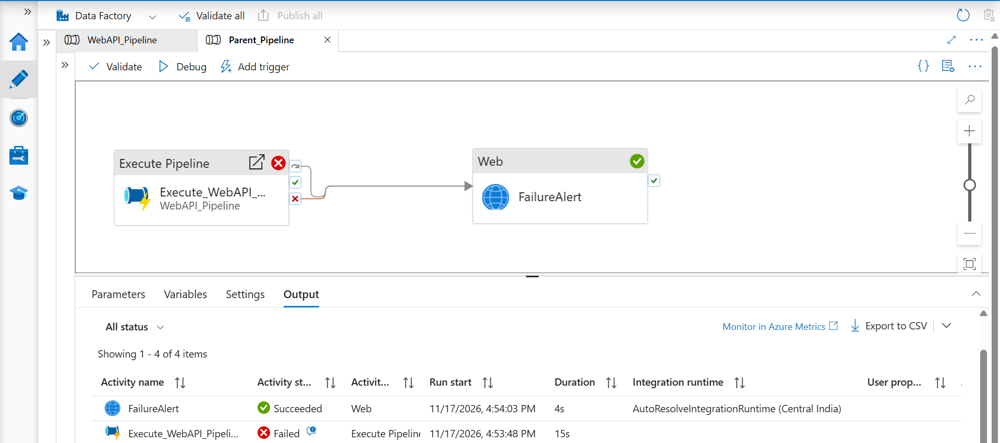
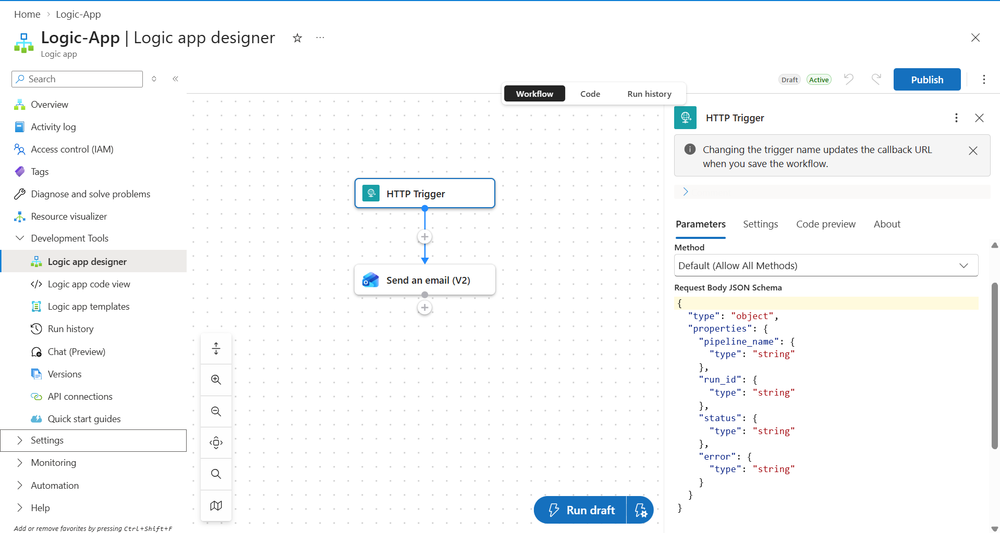

# ADF Failure Alerts with Azure Logic Apps and Outlook

An Azure Data Factory (ADF) pipeline that **sends me an email when a pipeline run fails**. The parent pipeline runs a child pipeline (which copies a CSV file from GitHub into the data lake). If the child fails or is skipped, a **Web activity** calls an **Azure Logic App**, and the Logic App sends an alert email through Outlook.



## What it does

```
Execute_WebAPI_Pipeline ──(on Failed or Skipped)──► FailureAlert (Web activity)
                                                          │  HTTP POST
                                                          ▼
                                            Logic App: HTTP trigger → Send an email (V2)
```

1. `Execute_WebAPI_Pipeline` runs the child pipeline `WebAPI_Pipeline` and waits for it to finish. The child copies a `.csv` file from GitHub to the `bronze` container.
2. If the child **fails** or is **skipped**, `FailureAlert` runs.
3. `FailureAlert` sends an HTTP POST with details about the run to the Logic App's HTTP trigger.
4. The Logic App sends an email to my Outlook inbox.

If the child succeeds, nothing is sent.

## What gets sent to the Logic App

The Web activity posts this JSON body (using ADF expressions):

```json
{
  "pipeline_name": "@{pipeline().Pipeline}",
  "run_id": "@{pipeline().RunId}",
  "status": "@{activity('Execute_WebAPI_Pipeline').Status}",
  "error": "@{if(equals(activity('Execute_WebAPI_Pipeline').Status, 'Failed'), string(activity('Execute_WebAPI_Pipeline').Error.Message), 'No Error')}"
}
```

The Logic App's HTTP trigger expects the same four string fields (`pipeline_name`, `run_id`, `status`, `error`), and uses them as dynamic content in the email.



## Example alert email

```
Pipeline is failed.
Pipeline: Parent_Pipeline
Status: Failed
Runid: <Runid>
Error: Operation on target WebAPICall failed: 404: Not Found
```

In this run, the child's `WebAPICall` step got a `404 Not Found` from the source, so the parent failed and the alert fired.

## Components

| Component | Details |
|---|---|
| Parent pipeline | `Parent_Pipeline` |
| Child pipeline | `WebAPI_Pipeline` (copies a CSV from GitHub to the `bronze` container) |
| Alert activity | `FailureAlert` (Web activity, POST), runs on **Failed** and **Skipped** |
| Logic App | Consumption plan, Stateful workflow |
| Logic App steps | HTTP trigger → Send an email (V2) using the Outlook.com connector |

## How to recreate it

1. **Create the Logic App** (Consumption plan, Stateful).
2. In the designer, add the trigger **When an HTTP request is received**. In the request body schema, add four string properties: `pipeline_name`, `run_id`, `status`, `error`.
3. Add the action **Send an email (V2)** (Outlook.com connector, sign in with your account). Write the subject and body using the dynamic content from the trigger.
4. **Save** the Logic App. The HTTP URL appears in the trigger. Copy it.
5. In ADF, open `Parent_Pipeline`, add a **Web** activity after the Execute Pipeline activity.
6. Draw the dependency arrows so it runs on **Failed** and **Skipped** (not Succeeded).
7. Set the Web activity: Method `POST`, URL = your Logic App URL, Body = the JSON above.
8. **Publish all** and **Debug**. To test, break the child pipeline on purpose (for example, a wrong source URL) and check that the email arrives.

## Project files

```
pipeline/
├── Parent_Pipeline.json      (Logic App URL replaced with a placeholder)
└── WebAPI_Pipeline.json
images/
```

Pipeline JSON was exported from ADF Studio using the **{ }** code view.
